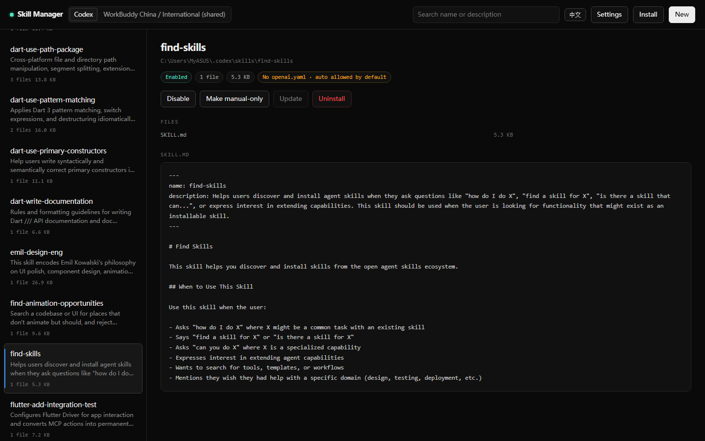

# Skill Manager

**English** | [简体中文](README.zh-CN.md)

A local manager for agent skills in Codex and WorkBuddy: browse, enable/disable, toggle auto-invocation, install from GitHub, update, and uninstall.



## Getting started

Double-click `start.cmd`, or:

```bash
node server.mjs
```

Open http://127.0.0.1:4780

## Sources

| Source | Default directory |
| --- | --- |
| Codex | `~/.codex/skills` |
| WorkBuddy China | `~/.workbuddy-ai/skills` |
| WorkBuddy International | `~/.workbuddy-ai/skills` |

If the China and International builds are installed separately, set their skill folders in **Settings**. When both point to the same directory they are merged into one tab marked "shared". Configuration lives in `~/.skill-manager/config.json`.

Disabled skills are moved to a sibling `skills-disabled/` folder, not deleted.

## Internationalization

Chinese and English UI, switchable from the top-right corner. The choice is stored in `localStorage`; the default follows the browser language. Force a language with `?lang=en`.

## Features

- **List / search** — name, description, file count, size, auto-invocation state
- **Details** — full SKILL.md, file list, source repository
- **Enable / disable** — moves the folder between `skills` and `skills-disabled`
- **Auto-invocation toggle** — writes `allow_implicit_invocation` in `agents/openai.yaml`
- **Install** — from a GitHub `owner/repo`, auto-detects skills under `skills/`; multi-skill repos return a candidate list first
- **Update** — re-fetches using the `.skill-source.json` written at install time, backing up first
- **Uninstall** — moves the folder to `~/.skill-manager/backups/<timestamp>/`
- **Create** — generates a SKILL.md template
- **Source settings** — custom skill directory per source

## Safety

- Listens on `127.0.0.1` only
- Skill names are whitelisted; path traversal is rejected
- Backups are taken before uninstall and update
- Never calls Codex commands and never touches `config.toml` or `auth.json`

## Backups

```
~/.skill-manager/backups/<ISO timestamp>/<action>-<skill>/<skill>/
```
