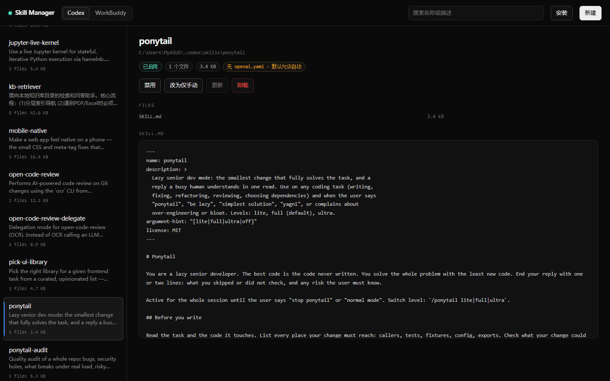

# Skill Manager

本地技能管理器：查看、启用/禁用、切换自动调用、安装、更新、卸载 Codex 与 WorkBuddy 的技能。



## 启动

双击 `start.cmd`，或：

```bash
node server.mjs
```

打开 http://127.0.0.1:4780

## 管理范围

| 来源 | 目录 |
| --- | --- |
| Codex | `~/.codex/skills` |
| WorkBuddy | `~/.workbuddy-ai/skills` |

禁用的技能移到同级 `skills-disabled/`，不删除。

## 功能

- **列表 / 搜索**：名称、描述、文件数、大小、是否可自动调用
- **详情**：SKILL.md 全文、文件清单、来源仓库
- **启用 / 禁用**：目录在 `skills` 与 `skills-disabled` 之间移动
- **自动调用开关**：写 `agents/openai.yaml` 的 `allow_implicit_invocation`
- **安装**：从 GitHub `owner/repo` 下载，自动识别 `skills/` 下的技能
- **更新**：按安装时写入的 `.skill-source.json` 重新拉取，先备份
- **卸载**：移到 `~/.skill-manager/backups/<时间戳>/`
- **新建**：生成 SKILL.md 模板

## 安全边界

- 只监听 `127.0.0.1`
- 技能名白名单校验，禁止路径穿越
- 卸载与更新前先复制备份
- 不调用任何 Codex 命令，不改 `config.toml`、`auth.json`

## 备份位置

```
~/.skill-manager/backups/<ISO 时间戳>/<动作>-<技能名>/<技能名>/
```
