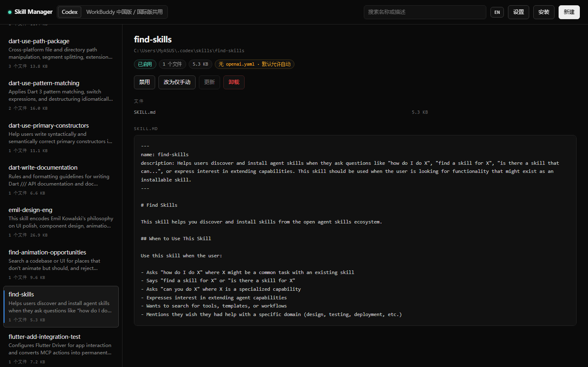

# Skill Manager

[English](README.md) | **简体中文**

本地技能管理器：查看、启用/禁用、切换自动调用、安装、更新、卸载 Codex 与 WorkBuddy 的技能。



## 启动

双击 `start.cmd`，或：

```bash
node server.mjs
```

打开 http://127.0.0.1:4780

## 管理范围

| 来源 | 默认目录 |
| --- | --- |
| Codex | `~/.codex/skills` |
| WorkBuddy 中国版 | `~/.workbuddy-ai/skills` |
| WorkBuddy 国际版 | `~/.workbuddy-ai/skills` |

国际版与中国版若为独立安装，在「设置」里分别指定技能目录即可；两者指向同一目录时会自动合并为一个标签，标注「共用」。配置保存在 `~/.skill-manager/config.json`。

禁用的技能移到同级 `skills-disabled/`，不删除。

## 多语言

中文 / English 两种界面，右上角切换，选择记在 `localStorage`。默认跟随浏览器语言，也可用 `?lang=en` 强制指定。

## 功能

- **列表 / 搜索**：名称、描述、文件数、大小、是否可自动调用
- **详情**：SKILL.md 全文、文件清单、来源仓库
- **启用 / 禁用**：目录在 `skills` 与 `skills-disabled` 之间移动
- **自动调用开关**：写 `agents/openai.yaml` 的 `allow_implicit_invocation`
- **安装**：从 GitHub `owner/repo` 下载，自动识别 `skills/` 下的技能；多技能仓库先返回候选列表
- **更新**：按安装时写入的 `.skill-source.json` 重新拉取，先备份
- **卸载**：移到 `~/.skill-manager/backups/<时间戳>/`
- **新建**：生成 SKILL.md 模板
- **来源设置**：自定义每个来源的技能目录
- **重复检测**：扫描 `~/.codex/plugins/cache` 与 `~/.agents/skills`，标出同名副本（禁用一个可能仍被另一份加载）
- **生效提示**：所有改动都会提示「需新开任务生效」
- **配置编辑**：可视化编辑 `~/.codex/config.toml` 与 WorkBuddy 的 `app-config.json` / `settings.json`，每次保存前自动备份。账号级字段（model、provider、service_tier、推理强度）可编辑，但带风险提示并在保存前二次确认；密钥类字段保持只读。

## 安全边界

- 只监听 `127.0.0.1`
- 技能名白名单校验，禁止路径穿越
- 卸载与更新前先复制备份
- 不调用任何 Codex 命令，不改 `config.toml`、`auth.json`

## 备份位置

```
~/.skill-manager/backups/<ISO 时间戳>/<动作>-<技能名>/<技能名>/
```
